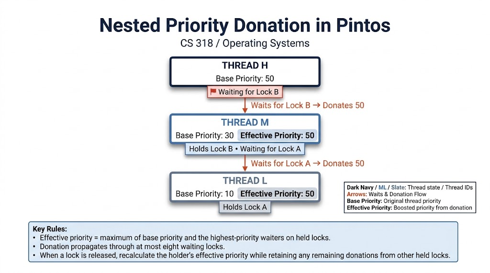

# Project 1: Threads

## Preliminaries

>Fill in your name and email address.

Chamath Jayasinghe chamath.24@cse.mrt.ac.lk

>If you have any preliminary comments on your submission, notes for the
>TAs, please give them here.

None.

>Please cite any offline or online sources you consulted while
>preparing your submission, other than the Pintos documentation, course
>text, lecture notes, and course staff.

[1] P. D. J. B. Karunarathne and D. E. W. V. Nanayakkara, "OS Prerequisite - Installing Pintos OS," [Course Code: Course Name], University of Moratuwa, 2026. [Online]. Available: https://online.uom.lk/pluginfile.php/1059836/mod_resource/content/2/OS%20Prerequisite%20-%20Installing%20Pintos%20OS.pdf

[2] PKU-OS, "pintos," GitHub repository. [Online]. Available: https://github.com/PKU-OS/pintos

[3] jhu-cs318, "pintos," GitHub repository. [Online]. Available: https://github.com/jhu-cs318/pintos

[4] PKU Flying Pig, "Your Tasks - Lab 1: Threads," Pintos. [Online]. Available: https://pkuflyingpig.gitbook.io/pintos/project-description/lab1-threads/your-tasks.

## Alarm Clock

#### DATA STRUCTURES

>A1: Copy here the declaration of each new or changed struct or struct member, global or static variable, typedef, or enumeration.  Identify the purpose of each in 25 words or less.

	int64_t wakeup_tick;               

	static struct list sleeping_list;

`wakeup_tick` stores the absolute tick when a sleeping thread should wake.
`sleeping_list` stores blocked sleeping threads in wakeup-tick order.


#### ALGORITHMS

>A2: Briefly describe what happens in a call to timer_sleep(),
>including the effects of the timer interrupt handler.

`timer_sleep(ticks)`:
1. Returns immediately if `ticks <= 0`.
2. Disables interrupts and calculates target wakeup time (`timer_ticks() + ticks`).
3. Inserts the current thread into `sleeping_list` in ascending order of `wakeup_tick`.
4. Calls `thread_block()` to yield execution and transitions thread state to `THREAD_BLOCKED`.
5. Restores original interrupt level.

`timer_interrupt()`:
1. Increments global tick count `ticks`.
2. Checks the front of `sleeping_list`; pops and calls `thread_unblock()` for every thread whose `wakeup_tick <= ticks`.
3. Halts list traversal at the first thread whose `wakeup_tick > ticks`.


>A3: What steps are taken to minimize the amount of time spent in
>the timer interrupt handler?

The sleeping list is ordered by wakeup tick.  The interrupt handler checks
only the front of the list and stops when the first wakeup tick is in the
future.  It therefore removes only threads that are ready to wake instead
of scanning every sleeping thread on every timer tick.


#### SYNCHRONIZATION

>A4: How are race conditions avoided when multiple threads call
>timer_sleep() simultaneously?

Each call disables interrupts before reading the current tick, setting its
`wakeup_tick`, and inserting its thread into `sleeping_list`.  This makes
each insertion atomic with respect to other threads and timer interrupts.


>A5: How are race conditions avoided when a timer interrupt occurs
>during a call to timer_sleep()?

Interrupts remain disabled from before the thread is inserted until after
`thread_block()` changes its state to `THREAD_BLOCKED`.  A timer interrupt
therefore cannot occur between checking the time and blocking the thread,
so it cannot miss the newly sleeping thread.


#### RATIONALE

>A6: Why did you choose this design?  In what ways is it superior to
>another design you considered?

Blocking sleeping threads eliminates the CPU waste of busy-waiting (`thread_yield()`). Maintaining an ordered list provides $O(1)$ amortized wakeups per timer interrupt rather than repeatedly polling thread sleep durations. Reusing `thread->elem` avoids dynamic memory allocation.


## Priority Scheduling

#### DATA STRUCTURES

>B1: Copy here the declaration of each new or changed struct or struct member, global or static variable, typedef, or enumeration.  Identify the purpose of each in 25 words or less.

	int priority;                    /* Effective priority. */
	int base_priority;               /* Priority without donations. */
	int nice;                         /* Niceness for the MLFQS. */
	int recent_cpu;                   /* Recent CPU in fixed-point format. */
	struct list locks_held;           /* Locks currently held. */
	struct lock *waiting_lock;        /* Lock this thread is waiting for. */
	struct semaphore *waiting_semaphore; /* Semaphore containing this thread. */

	struct list_elem holder_elem;     /* Element in the holder's lock list. */

`priority` is effective priority; `base_priority` preserves the thread's
own priority.  The remaining fields track donation relationships and MLFQS
state.


>B2: Explain the data structure used to track priority donation.
>Use ASCII art to diagram a nested donation.  (Alternately, submit a
>.png file.)

Each thread stores its base and effective priorities, the locks it holds,
and the lock it is currently waiting for.  Each lock has a `holder_elem`
so it can be listed in its holder's `locks_held` list.  A thread's effective
priority is the maximum of its base priority and the highest-priority waiter
on each held lock.  Recalculation propagates through at most eight waiting
locks.



The donation is removed by recomputing the holder's priority after a lock is
released; remaining donations from other held locks are retained.


#### ALGORITHMS

>B3: How do you ensure that the highest priority thread waiting for
>a lock, semaphore, or condition variable wakes up first?

Ready lists, semaphore waiters, and condition-variable waiters use ordered
insertion with descending effective priority.  Equal-priority threads are
inserted after existing equal-priority threads, preserving FIFO order.
When a higher-priority thread becomes ready, the current thread yields, or
an interrupt requests a yield on return.


>B4: Describe the sequence of events when a call to lock_acquire()
>causes a priority donation.  How is nested donation handled?

1. Current thread sets `waiting_lock` to the target lock.
2. If the lock is held, the thread inserts itself into `lock->semaphore.waiters` in priority order.
3. If current priority exceeds the holder's priority, the holder's priority is raised.
4. Nested donation: If the holder is also waiting on a lock (`holder->waiting_lock`), donation propagates to that lock's holder recursively, up to `DONATION_DEPTH` (8).
5. The thread sleeps via `sema_down()`.
6. Once acquired, `waiting_lock` is cleared, the lock is added to `locks_held`, and priority is recalculated.


>B5: Describe the sequence of events when lock_release() is called
>on a lock that a higher-priority thread is waiting for.

1. The lock is removed from the releasing thread's `locks_held` list and `lock->holder` is cleared.
2. The releasing thread recalculates its effective priority as the maximum of its `base_priority` and the highest waiter across its remaining `locks_held`.
3. `sema_up()` is invoked, unblocking the highest-priority waiter from `sema->waiters`.
4. If the unblocked waiter has higher priority than the releasing thread, the releasing thread immediately yields the CPU via `thread_yield()`.


#### SYNCHRONIZATION

>B6: Describe a potential race in thread_set_priority() and explain
>how your implementation avoids it.  Can you use a lock to avoid
>this race?

The race occurs if a priority change is interleaved with a timer interrupt
or a waiter being added to a lock.  The implementation disables interrupts
while changing `base_priority`, recalculating effective priority, and
checking whether a higher-priority ready thread should run.  A normal lock
is unsuitable because it may block and cannot be used in interrupt context;
interrupt disabling provides the required short atomic section.


#### RATIONALE

>B7: Why did you choose this design?  In what ways is it superior to
>another design you considered?

Keeping base priority separate from effective priority makes donation
reversible and supports multiple simultaneous donations.  Tracking held
locks and the current waiting lock makes nested propagation direct and
avoids dynamically allocating donation records.  The tradeoff is that
recalculation scans held locks and propagates through a bounded chain, but
this keeps lock release and donation behavior easy to reason about.


## Advanced Scheduler

#### DATA STRUCTURES

>C1: Copy here the declaration of each new or changed struct or struct member, global or static variable, typedef, or enumeration.  Identify the purpose of each in 25 words or less.

In `struct thread` (`src/threads/thread.h`):
```c
int nice;                           /* Niceness for the MLFQS. */
int recent_cpu;                     /* Recent CPU in fixed-point format. */
```
- `nice`: User-set niceness (-20 to 20) determining thread scheduling priority.
- `recent_cpu`: Moving average of CPU execution time received by the thread.

In `src/threads/thread.c`:
```c
#define FP_SHIFT 14
#define FP_ONE (1 << FP_SHIFT)
static int load_avg;                /* System load average in 17.14 fixed point. */
static int64_t mlfqs_ticks;         /* Tick counter for MLFQS periodic recalculations. */
```
- `FP_SHIFT` / `FP_ONE`: Q14 scaling constants (14 fractional bits) for 17.14 fixed-point arithmetic.
- `load_avg`: System load average in 17.14 format estimating runnable threads over the past minute.
- `mlfqs_ticks`: Tick counter scheduling MLFQS recalculation intervals (1, 4, and 100 ticks).


#### ALGORITHMS

>C2: How is the way you divided the cost of scheduling between code
>inside and outside interrupt context likely to affect performance?

Inside timer interrupt:
- Every tick: `recent_cpu` of current thread is incremented by 1.
- Every 4 ticks: Priorities of all threads are recalculated and `ready_list` is resorted.
- Every 100 ticks (1 second): `load_avg` and `recent_cpu` for all threads are recomputed.

Performance impact:
Performing $O(N \log N)$ list sorting and $O(T)$ thread iterations within the timer interrupt handler increases interrupt latency and CPU overhead as thread count grows. Moving updates to thread yield/sleep transitions or utilizing multi-level priority arrays would reduce interrupt latency.


#### RATIONALE

>C3: Briefly critique your design, pointing out advantages and
>disadvantages in your design choices.  If you were to have extra
>time to work on this part of the project, how might you choose to
>refine or improve your design?

The MLFQS design uses simple periodic updates and a sorted ready list, so
its scheduling behavior is easy to follow and does not require dynamic
allocation.  Its disadvantages are interrupt-context arithmetic, repeated
ready-list sorting, and bounded integer precision.  I would optimize the
ready-list updates and add focused fixed-point unit tests to improve both
latency and confidence in rounding behavior.


>C4: The assignment explains arithmetic for fixed-point math in
>detail, but it leaves it open to you to implement it.  Why did you
>decide to implement it the way you did?  If you created an
>abstraction layer for fixed-point math, that is, an abstract data
>type and/or a set of functions or macros to manipulate fixed-point
>numbers, why did you do so?  If not, why not?

Implemented using signed 17.14 fixed-point integer arithmetic (`FP_SHIFT = 14`, `FP_ONE = 1 << 14`) with 64-bit casting (`int64_t`) for intermediate multiplication products to prevent 32-bit overflow.
Direct macro/inline expressions were used instead of an abstract data type to avoid function call overhead and compiler abstraction penalties within time-critical kernel interrupt handlers while keeping code simple and self-contained.
