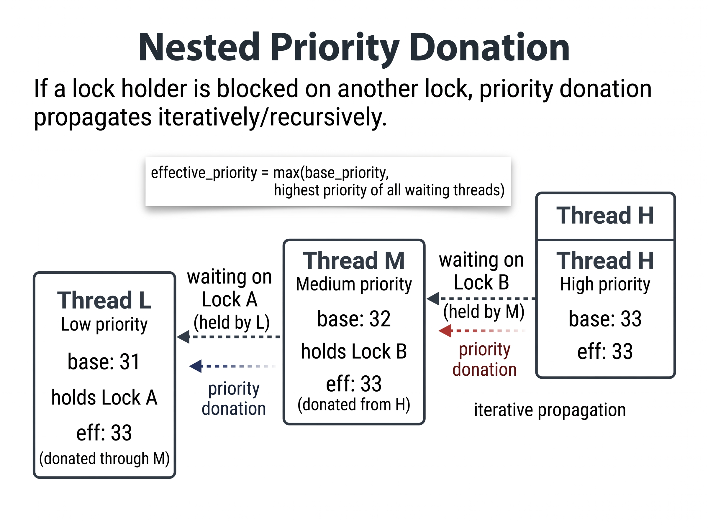

# Project 1: Threads

## Preliminaries

>Fill in your name and email address.

Chamath Jayasinghe <chamath.24@cse.mrt.ac.lk>

>If you have any preliminary comments on your submission, notes for the
>TAs, please give them here.

None.

>Please cite any offline or online sources you consulted while
>preparing your submission, other than the Pintos documentation, course
>text, lecture notes, and course staff.

[1] PKU-OS, "pintos," GitHub repository. [Online]. Available: https://github.com/PKU-OS/pintos
[2] PKU Flying Pig, "Lab 1: Threads," Pintos Guide. [Online]. Available: https://pkuflyingpig.gitbook.io/pintos/project-description/lab1-threads/your-tasks
[3] Stanford CS 140 Pintos Documentation and Guides.


## Alarm Clock

#### DATA STRUCTURES

>A1: Copy here the declaration of each new or changed struct or struct member, global or static variable, typedef, or enumeration.  Identify the purpose of each in 25 words or less.

In `struct thread` (`src/threads/thread.h`):
```c
int64_t wakeup_tick;                /* Tick at which the thread wakes. */
```
- `wakeup_tick`: Records the absolute system tick count when the sleeping thread should be unblocked.

In `src/devices/timer.c`:
```c
static struct list sleeping_list;   /* Threads blocked in timer_sleep(), ordered by wakeup_tick. */
```
- `sleeping_list`: Global list of all sleeping threads sorted in ascending order of their `wakeup_tick`.


#### ALGORITHMS

>A2: Briefly describe what happens in a call to timer_sleep(),
>including the effects of the timer interrupt handler.

`timer_sleep(ticks)`:
1. Returns immediately if `ticks <= 0`.
2. Disables interrupts and calculates target wakeup time (`timer_ticks() + ticks`).
3. Inserts the current thread into `sleeping_list` in ascending order of `wakeup_tick`.
4. Calls `thread_block()` to yield execution and transitions thread state to `THREAD_BLOCKED`.
5. Restores original interrupt level.

`timer_interrupt()`:
1. Increments global tick count `ticks`.
2. Checks the front of `sleeping_list`; pops and calls `thread_unblock()` for every thread whose `wakeup_tick <= ticks`.
3. Halts list traversal at the first thread whose `wakeup_tick > ticks`.


>A3: What steps are taken to minimize the amount of time spent in
>the timer interrupt handler?

`sleeping_list` is maintained in sorted order by `wakeup_tick`. The timer interrupt handler only inspects elements from the head and breaks immediately once it encounters a thread whose wakeup tick is in the future, avoiding an $O(N)$ scan of all sleeping threads on every tick.


#### SYNCHRONIZATION

>A4: How are race conditions avoided when multiple threads call
>timer_sleep() simultaneously?

Interrupts are disabled via `intr_disable()` before reading `ticks`, setting `wakeup_tick`, and inserting the thread into `sleeping_list`. This enforces mutual exclusion and atomic list insertion.


>A5: How are race conditions avoided when a timer interrupt occurs
>during a call to timer_sleep()?

Interrupts remain disabled continuously from before the thread is placed on `sleeping_list` through the completion of `thread_block()`. A timer interrupt cannot execute between list insertion and thread blocking, preventing missed wakeup events.


#### RATIONALE

>A6: Why did you choose this design?  In what ways is it superior to
>another design you considered?

Blocking sleeping threads eliminates the CPU waste of busy-waiting (`thread_yield()`). Maintaining an ordered list provides $O(1)$ amortized wakeups per timer interrupt rather than repeatedly polling thread sleep durations. Reusing `thread->elem` avoids dynamic memory allocation.


## Priority Scheduling

#### DATA STRUCTURES

>B1: Copy here the declaration of each new or changed struct or struct member, global or static variable, typedef, or enumeration.  Identify the purpose of each in 25 words or less.

In `struct thread` (`src/threads/thread.h`):
```c
int priority;                       /* Effective priority. */
int base_priority;                  /* Priority without donations. */
int nice;                           /* Niceness for the MLFQS. */
int recent_cpu;                     /* Recent CPU in fixed-point format. */
struct list locks_held;             /* Locks currently held. */
struct lock *waiting_lock;          /* Lock this thread is waiting for. */
struct semaphore *waiting_semaphore;/* Semaphore containing this thread. */
```
- `priority`: Current effective priority, accounting for priority donations or MLFQS calculation.
- `base_priority`: Base priority set by `thread_set_priority`, preserved across priority donations.
- `nice`: Thread niceness value (-20 to 20) determining CPU favorability under MLFQS.
- `recent_cpu`: Exponential moving average of CPU ticks received by thread in 17.14 fixed-point format.
- `locks_held`: List of all locks currently acquired by this thread.
- `waiting_lock`: Pointer to the lock this thread is currently blocked on.
- `waiting_semaphore`: Pointer to the semaphore this thread is currently waiting on.

In `struct lock` (`src/threads/synch.h`):
```c
struct list_elem holder_elem;       /* Element in holder's locks_held list. */
```
- `holder_elem`: List element used to link this lock into the holding thread's `locks_held` list.

In `struct semaphore_elem` (`src/threads/synch.c`):
```c
struct thread *thread;              /* Thread waiting on this condition. */
```
- `thread`: Pointer to the waiting thread to enable priority-ordered condition variable wakeups.

In `src/threads/thread.c`:
```c
#define DONATION_DEPTH 8            /* Maximum depth of nested priority donation. */
```
- `DONATION_DEPTH`: Bounded recursion depth limit (8) for nested priority donation chains.


>B2: Explain the data structure used to track priority donation.
>Use ASCII art to diagram a nested donation.  (Alternately, submit a
>.png file.)

Each thread retains its `base_priority` and a list of acquired locks (`locks_held`). When waiting on an unavailable lock, `waiting_lock` is recorded. The effective priority is computed as `max(base_priority, highest priority of all threads waiting on locks in locks_held)`. If the lock holder is blocked on another lock, the priority donation propagates iteratively/recursively up to `DONATION_DEPTH` (8 levels). When a lock is released, it is removed from `locks_held` and the thread's priority is recomputed from its remaining held locks.




#### ALGORITHMS

>B3: How do you ensure that the highest priority thread waiting for
>a lock, semaphore, or condition variable wakes up first?

Waiters lists (`sema->waiters` and `cond->waiters`) and `ready_list` are maintained in descending priority order via `list_insert_ordered()`. On `sema_up()` and `cond_signal()`, `list_pop_front()` removes and unblocks the highest-priority waiter. If the unblocked thread has higher priority than the running thread, `thread_yield()` immediately preempts the running thread.


>B4: Describe the sequence of events when a call to lock_acquire()
>causes a priority donation.  How is nested donation handled?

1. Current thread sets `waiting_lock` to the target lock.
2. If the lock is held, the thread inserts itself into `lock->semaphore.waiters` in priority order.
3. If current priority exceeds the holder's priority, the holder's priority is raised.
4. Nested donation: If the holder is also waiting on a lock (`holder->waiting_lock`), donation propagates to that lock's holder recursively, up to `DONATION_DEPTH` (8).
5. The thread sleeps via `sema_down()`.
6. Once acquired, `waiting_lock` is cleared, the lock is added to `locks_held`, and priority is recalculated.


>B5: Describe the sequence of events when lock_release() is called
>on a lock that a higher-priority thread is waiting for.

1. The lock is removed from the releasing thread's `locks_held` list and `lock->holder` is cleared.
2. The releasing thread recalculates its effective priority as the maximum of its `base_priority` and the highest waiter across its remaining `locks_held`.
3. `sema_up()` is invoked, unblocking the highest-priority waiter from `sema->waiters`.
4. If the unblocked waiter has higher priority than the releasing thread, the releasing thread immediately yields the CPU via `thread_yield()`.


#### SYNCHRONIZATION

>B6: Describe a potential race in thread_set_priority() and explain
>how your implementation avoids it.  Can you use a lock to avoid
>this race?

Race: A priority change could interleave with priority donation from another thread or a timer interrupt preemption, leaving the effective priority or queue positions inconsistent.
Avoidance: Interrupts are disabled (`intr_disable()`) during `base_priority` assignment, effective priority recalculation, and the preemption check (`thread_yield()`).
Locks cannot be used because priority manipulation occurs within scheduling and interrupt contexts where sleeping/blocking on a lock is strictly forbidden.


#### RATIONALE

>B7: Why did you choose this design?  In what ways is it superior to
>another design you considered?

Tracking held locks (`locks_held`) and the blocked lock (`waiting_lock`) allows effective priority to be recomputed dynamically from existing structures without separate dynamic memory allocation. Separating `base_priority` from `priority` naturally supports multiple and nested donations while ensuring clean restoration when locks are released.


## Advanced Scheduler

#### DATA STRUCTURES

>C1: Copy here the declaration of each new or changed struct or struct member, global or static variable, typedef, or enumeration.  Identify the purpose of each in 25 words or less.

In `struct thread` (`src/threads/thread.h`):
```c
int nice;                           /* Niceness for the MLFQS. */
int recent_cpu;                     /* Recent CPU in fixed-point format. */
```
- `nice`: User-set niceness (-20 to 20) determining thread scheduling priority.
- `recent_cpu`: Moving average of CPU execution time received by the thread.

In `src/threads/thread.c`:
```c
#define FP_SHIFT 14
#define FP_ONE (1 << FP_SHIFT)
static int load_avg;                /* System load average in 17.14 fixed point. */
static int64_t mlfqs_ticks;         /* Tick counter for MLFQS periodic recalculations. */
```
- `FP_SHIFT` / `FP_ONE`: Q14 scaling constants (14 fractional bits) for 17.14 fixed-point arithmetic.
- `load_avg`: System load average in 17.14 format estimating runnable threads over the past minute.
- `mlfqs_ticks`: Tick counter scheduling MLFQS recalculation intervals (1, 4, and 100 ticks).


#### ALGORITHMS

>C2: How is the way you divided the cost of scheduling between code
>inside and outside interrupt context likely to affect performance?

Inside timer interrupt:
- Every tick: `recent_cpu` of current thread is incremented by 1.
- Every 4 ticks: Priorities of all threads are recalculated and `ready_list` is resorted.
- Every 100 ticks (1 second): `load_avg` and `recent_cpu` for all threads are recomputed.

Performance impact:
Performing $O(N \log N)$ list sorting and $O(T)$ thread iterations within the timer interrupt handler increases interrupt latency and CPU overhead as thread count grows. Moving updates to thread yield/sleep transitions or utilizing multi-level priority arrays would reduce interrupt latency.


#### RATIONALE

>C3: Briefly critique your design, pointing out advantages and
>disadvantages in your design choices.  If you were to have extra
>time to work on this part of the project, how might you choose to
>refine or improve your design?

Advantages: Straightforward implementation, fully compliant with MLFQS specifications, requires no dynamic memory allocation, and reuses existing list primitives.
Disadvantages: Sorting `ready_list` in interrupt context adds overhead; iterating all threads every second introduces periodic latency spikes.
Improvements: Replace the single sorted `ready_list` with 64 discrete priority queues (`struct list ready_queues[64]`) and a priority bitmap to achieve $O(1)$ enqueue, dequeue, and scheduling operations.


>C4: The assignment explains arithmetic for fixed-point math in
>detail, but it leaves it open to you to implement it.  Why did you
>decide to implement it the way you did?  If you created an
>abstraction layer for fixed-point math, that is, an abstract data
>type and/or a set of functions or macros to manipulate fixed-point
>numbers, why did you do so?  If not, why not?

Implemented using signed 17.14 fixed-point integer arithmetic (`FP_SHIFT = 14`, `FP_ONE = 1 << 14`) with 64-bit casting (`int64_t`) for intermediate multiplication products to prevent 32-bit overflow.
Direct macro/inline expressions were used instead of an abstract data type to avoid function call overhead and compiler abstraction penalties within time-critical kernel interrupt handlers while keeping code simple and self-contained.